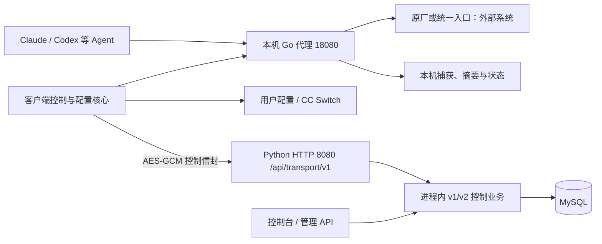

# EndpointAIProxy 项目地图

2026-11-04 文档同步，最近本机验证日期为 2026-11-03。当前优化实现、交付包摘要和未通过的门禁统一见
[当前交付结果](docs/OPTIMIZATION-CURRENT-RESULT.md)。启用工号派生表时的实时搜索
已改为逐设备关联检查；本机隔离 MySQL 回归通过，宽泛查询仍超过建议时延门槛。
控制台写操作已补齐本地角色限制；Chrome、Edge 与隔离 MySQL 下的三角色及工号搜索
回归通过，完整浏览器和真实终端验收仍以当前结果记录为准。
已追加三项策略交互及六视图桌面/移动端实际截图检查，并补充批次权限说明；
本机验证范围和环境阻断详见当前结果。
下文较早版本记录保留历史背景，不能替代当前包的验收。

当前新增默认关闭的[设备凭据两阶段轮换候选](server/docs/CREDENTIAL-ROTATION-CANDIDATE.md)，
涉及可选 schema 6、Go 受保护待更新状态及原子提交；已纳入 r77 隔离源码和 0.2.21 r2
客户端验收材料。跨语言断点与真实备份恢复 9 项通过，Go 全量测试、vet、未签名 MSI
静态检查和 Mac 两架构交叉编译通过；未安装、未部署，独立终端及 Linux 门禁待验。
schema 6 激活后禁止直接降回 r75 或更早程序，旧客户端无法恢复未完成的待轮换记录。

0.2.21 r2 已补充控制事件队列的本地健康计数和长稳时间线采样，包含读取失败为未知、
恢复合并暂达 2000 的观测及每批 100 的排空测试。全量 Go、vet、MSI 静态检查和 Mac
两架构交叉编译通过；212 个构建源输入与当前文件核对，未安装或完成原生 8 小时。
该增量不包含在 0.2.20，r77 控制端源码不变；逐项实现与验收边界见
[完成度核对](docs/OPTIMIZATION-COMPLETION-AUDIT-20261103.md)。

当前全目标验收受隔离 Linux、独立终端结果及部署设施证据阻断；最终包和构建输入已再次
核对。外部条件以[完成度核对](docs/OPTIMIZATION-COMPLETION-AUDIT-20261103.md)为准；
本机私有证据另存 `private/acceptance/final-blocker-audit-20261103.md`，不随 Git 分发。
不把历史单测、交叉编译或本机实验替代原生与容量门禁。

## 历史进度与模块入口

以下按原日期保留版本演进和现场记录；其中“当前”“尚未”等状态仅对应当时，
当前候选和未完成项以上述交付结果为准。Git 提交/推送不表示已部署或通过推广验收。

2026-10-28 最新推广口径：控制端长稳验收为 **8 小时**；Windows 推广包不签名，
仍须绑定最终包摘要完成原生与 IOA 验收。Mac 正式签名、公证要求不变。

本地控制端 0.1.26 候选现使用 schema 5，包含命令批次和 v2 策略批次，尚未部署；
服务端交付打包在隔离 Linux 升级、回滚验证前拒绝执行。schema 3/4 升级、备份与
受限回退的本机合成验证不代替 Linux 实操。相关限制及规模数据见规模优化记录。

Windows 0.2.6 未签名验收候选已构建，未安装；0.2.5 及更早候选保留历史但不含
最新捕获容量保护。当前包和验收要求见 [Windows 交接](docs/WINDOWS-GO-026-HANDOFF.md)。
Mac 0.2.6 无凭据源码包和签名、公证要求见 [Mac 交接](docs/MACOS-GO-026-HANDOFF.md)；
原生验收和签名公证仍待用户执行。客户端工号和异常派生索引需停服回填并一致启用。

2026-10-28 [规模优化工作树记录](server/docs/SCALE-IMPLEMENTATION-20261028.md)记录本地
Go/Python 改动、兼容性、隔离验证和仍未完成的推广阻断项；未部署，不能作为 15 万端放行证明。

2026-10-28 工作树新增[域名白名单、地址分流及工号展示](server/docs/DOMAIN-ROUTING.md)。
Go 支持策略 schema 1/2 协商；Python 复用数据库 schema 3 的 JSON 字段，旧客户端继续 schema 1。
控制台单终端策略自动加载并保留冲突草稿。仅本机隔离验证，尚未生产部署或生成新安装包；
Linux 多 worker、离线发布依赖及 Windows/Mac 原生试点门禁见该记录。

最后核查：2026-10-24。范围：Win/Mac 客户端与生产 Python 服务端；不覆盖外部模型网关内部实现。
本文记录架构与维护入口，不是发布通过证明。开始任务时，先确定目标组件，再读对应源码及验收记录。
2026-10-26 Windows **0.2.4-r3** IOA 验收候选已构建并冻结：补齐 Desktop rc.3 账户版本支持、固定 SYSTEM 验收用户与证据 ACL、
增加有效网关健康字段及 IOA 静默安装/检测入口，默认新 zbx 网关。Go 全量测试/vet、MSI 静态及载荷/权限表复核、
12 项验收支持、10 项部署检测、6 项 32/64 位原生 PowerShell 入口检查通过；r1/r2 未安装的中间包已撤换。
本轮没有安装新 MSI、启动真实长稳或修改现网策略。源码事实、候选验证及待验门禁见
[Windows 0.2.4 记录](docs/WINDOWS-024-ACCEPTANCE.md)。尚未形成可全量推广结论；干净终端与 IOA 试点由用户收包后执行。
用户已确认 r15 Codex 桌面 DeepSeek 对话正常，独立 r15 报告已完成升级/重启/卸载等阶段；其 rc.3 与 SYSTEM 核验问题留待新包复测。
下面有关桌面未验、独立报告待回传的表述为原 r15 历史进度，不覆盖本轮用户确认，也不等于 0.2.4 通过。
2026-10-26 新网关端口 80 的本机 Claude、Codex CLI/桌面引擎及 DSH 账户模型列表/两轮对话的真实请求和 SSE 通过。
临时网关和 Codex OpenAI 配置已恢复；Codex 桌面无法选择 DeepSeek 模型，界面对话仍未验收。
根路径 503、另一 /anthropic 请求 401、新网关长稳及独立终端未验项保留，详见 Windows 验收记录。
本文描述仓库支持的架构与部署流程；本次现场生产控制端已升级为 0.1.25/schema 3，不据此推断其他现场配置均已验收。

## 当前版本与事实来源

2026-10-24 [单终端策略覆盖](server/docs/DEVICE-POLICY.md)已部署至 Python 控制端 0.1.25/schema 3，
新增 device_policy_state（共 13 张表）。Linux 隔离验收 151 项通过、6 项跳过，
一致性备份恢复、迁移和安全回退边界通过；现场原数据根目录保留。
本地浏览器保存/CAS/继承、Linux 多 worker 加密 HTTP 并发，以及目标 Windows 的白名单直连、
撤销覆盖、真实暂停/恢复回执和 Claude 请求通过。全局及其他 57 台终端策略未变。
目标策略已撤销覆盖，但已签发的版本水位必须保留，禁止直接降回 0.1.24；后续故障应向前修复。
备用 IP 网关请求 403，恢复原域名后成功；新正式网关仍未验收，Windows 独立终端门禁仍阻断推广。

2026-10-22 Windows 本地扩展候选为 **0.2.3**，基于下列 0.2.2 冻结源码。
Codex 排除、生产网关构建参数、Desktop rc.2 账户 origin 与验收状态见
[Windows 0.2.3 记录](docs/WINDOWS-023-ACCEPTANCE.md)。原生验收尚未完成，不是推广通过结论。
原生 r9 卸载失败后的 CC Switch 解除接管修复正在重新验收，详见同一记录。
r11 的控制恢复发现 Desktop 关闭时未接管账户 profile 被误记为硬失败；修复及新候选验收见同一记录。
2026-10-23 r12 Codex 预检又发现 ChatGPT 默认入口被误认成 API 默认入口；登录模式识别修复及重新验收门禁见同一记录，当前仍禁止推广。
同日 r13 的 Codex DeepSeek 真实请求通过后，原生卸载发现 Desktop rc.2 被通用引用检查误用旧 alpha 版本门禁，导致无引用的旧路由残留；修复与新候选门禁见同一记录。
r14 辅助维护仍失败；进一步补齐 Desktop 引用范围与通用 Node 完整性标记的区分，并为维护失败输出脱敏阶段和固定错误码，待新候选原生重验。

2026-10-24 r15 原生安装生命周期、旧版升级/受控回滚、诊断和 Windows 四小时长稳已通过；
723 次请求的预期网关、完整 SSE、脱敏及最后两小时资源平台期证据齐备。
仍缺独立首装/重启等证据，新网关尚未合格，不能推广；详见同一 Windows 验收记录。

| 组件 | 当前定位 | 事实来源 |
|---|---|---|
| Go 客户端 0.2.21 r2 | Win/Mac 共用核心的候选实现，原生发行和长稳待验 | [Go 模块](go-client/go.mod)、[当前交付结果](docs/OPTIMIZATION-CURRENT-RESULT.md)、[完成度核对](docs/OPTIMIZATION-COMPLETION-AUDIT-20261103.md) |
| .NET 客户端 0.1.22 | 兼容基线与回退实现；不能因 Go 候选存在而删除 | [客户端项目](src/Sf.EndpointAI.Client.Service/Sf.EndpointAI.Client.Service.csproj)、[原 MSI](installer/Sf.EndpointAI.Setup/Package.wxs) |
| Python 服务端 0.1.25 / schema 3 | 生产控制面：Flask/Gunicorn、MySQL；单终端覆盖已部署并完成本机现场验收 | [服务端说明](server/README.md)、[入口](server/app.py)、[升级流程](deployment/README-SERVER-UPGRADE-0.1.25.md) |
| Python 服务端 0.1.26 r77 | 未部署的隔离源码候选；默认 schema 5，轮换需显式启用 schema 6；Linux 和容量门禁待验 | [当前交付结果](docs/OPTIMIZATION-CURRENT-RESULT.md)、[轮换边界](server/docs/CREDENTIAL-ROTATION-CANDIDATE.md) |
| ASP.NET 控制服务 | 保留的独立原型，不等同于生产 Python 服务端 | [原型源码](src/Sf.EndpointAI.ControlServer) |

不要混用客户端版本、服务端版本或测试包版本。源码工作树、构建清单、最终程序哈希和交付 ZIP 可能处于不同阶段；不得只依据文件名认定内容一致。
阶段报告会变化，本文不复制所有包哈希、证书信息或环境结果。

## 两条链路

模型请求走本机代理；控制通信负责注册、策略、心跳、资产、事件及远程命令。两条链路的请求 ID 不能混用。
生产服务端的分析基于心跳、资产和活动状态，不保存完整逐请求代理日志；仅凭控制台不能还原所有模型请求故障。

## 客户端模块与功能

| 入口/模块 | 负责什么 | 修改前重点 |
|---|---|---|
| [cmd/endpointai](go-client/cmd/endpointai/main.go) | 参数、服务启动、维护与诊断入口 | 先占监听端口再打开状态；维护解除接管要求停服 |
| [app](go-client/internal/app/app.go) | 策略、心跳、资产、命令、配置协调及健康 | 控制同步与启停状态、锁顺序、恢复中的命令回执 |
| [proxy](go-client/internal/proxy/proxy.go) | 路由、原厂/统一入口、白名单、转发、SSE、取消及元数据签名 | 原始 body、错误传播、即时刷新、请求头覆盖 |
| [configuration](go-client/internal/configuration) | Claude JSON、Codex TOML、CC Switch、DSH YAML 接管与解除 | 备份、并发检测、原子替换、原配置及用户后续修改 |
| [state](go-client/internal/state/store.go) | SQLite 身份、路由、凭据、策略、操作状态及命令回执 | 旧版 schema、枚举和密文兼容；在线备份、只读诊断 |
| [protocol](go-client/internal/protocol) / [control](go-client/internal/control/client.go) | AES-GCM/HKDF、签名、控制信封、HTTP 调用 | 原始字节验签、日期/字段序列化与设备绑定 |
| [platform](go-client/internal/platform) / [protect](go-client/internal/protect) / [instance](go-client/internal/instance) | 系统服务、用户身份、密钥保护及单实例 | Windows DPAPI/权限与 Mac 文件密钥不能互相代替 |
| [discovery](go-client/internal/discovery) | CLI/IDE/Desktop 安装、进程与 Agent 发现 | Qoder 仅发现，不修改非公开配置 |
| [audit](go-client/internal/audit/audit.go) | 正文捕获、摘要、运行日志、压缩及保留清理 | 业务捕获与运行日志是不同可靠性/性能路径 |
| [observability](go-client/internal/observability) | 固定错误分类、阶段与安全系统码；禁止任意原始错误文本持久化 | 平台 errno、控制 ID 与模型 ID 分开 |
| [diagnostics](go-client/internal/diagnostics) | 本地健康、系统证据和脱敏诊断包 | 有界采集、部分失败、字段白名单及最新证据完整性 |

Windows 使用原生 Windows Service，安装辅助程序为 Go；Mac 使用 root LaunchDaemon。
两端业务以同一清单验证，平台操作采用等价实现；编译通过不等于平台行为通过。

## 稳定契约与数据布局

| 项目 | 契约 |
|---|---|
| 本地代理 | `127.0.0.1:18080`、`/r/{routeId}`、`/healthz` |
| Windows 服务名 | `SfEndpointAIProxy` |
| Mac LaunchDaemon | `com.sf.endpointai.proxy` |
| Windows 数据根 | `%ProgramData%\SF\EndpointAIProxy` |
| Mac 数据根 | `/Library/Application Support/SF/EndpointAIProxy` |
| 状态与恢复 | 数据根下 `state/client.db`、`config-backups`；Mac 另有 `state/machine.key` |
| 证据 | 数据根下 `captures`、`logs/service`、`diagnostics`；安装事务另有平台安装日志与恢复目录 |
| 转发元数据 | 统一入口模式使用 `x-sf-userid`、`x-request-id`，覆盖调用者伪造值；原厂透传行为保持既有约定 |
| 兼容边界 | SQLite schema/枚举、设备与路由身份、凭据、策略缓存、命令回执、密文布局和签名规则 |

以上系统路径用于说明产品契约，不是开发机源码路径。源码链接均相对本仓库。
新旧客户端不得同时写同一状态库或接管同一份配置。不要用删除状态库、重建密钥或重新注册设备来掩盖兼容问题。
Windows 沿用 DPAPI；Mac 沿用机器密钥文件与既有密文布局。策略签名针对实际响应原始正文，不能反序列化再序列化后验签。
控制命令与转发元数据签名的字段值、顺序、编码和时间格式也属于兼容契约。

## 生产 Python 服务端

| 入口/模块 | 职责 |
|---|---|
| [start.py](server/start.py) / [app.py](server/app.py) | 私有配置加载、应用工厂、Gunicorn 与请求日志 |
| [transport.py](server/controlserver/transport.py) | `/api/transport/v1` 信封校验、解密、数据库重放保护、进程内业务分发与响应加密 |
| [routes_client.py](server/controlserver/routes_client.py) | 注册、策略、心跳、事件和命令状态；命令通过心跳下发 |
| [routes_admin.py](server/controlserver/routes_admin.py) / [console.py](server/controlserver/console.py) / [analytics.py](server/controlserver/analytics.py) | 管理、控制台与当前终端分析 |
| [database.py](server/controlserver/database.py) / [数据库定义](server/conf/endpoint_ai_proxy.sql) | 事务、资产、策略、设备认证、命令租约、审计及结构检查 |
| [security.py](server/controlserver/security.py) / [validation.py](server/controlserver/validation.py) | 序列化、签名、认证比较与输入验证 |
| [backup.py](server/controlserver/backup.py) | 独立备份与恢复维护能力 |

0.1.24 部署基线 schema version 为 **2**，12 张表：`transport_replay`、`schema_migrations`、`control_policy`、`device_credentials`、`device_heartbeats`、`agent_inventory`、`device_runtime`、`agent_endpoint_assets`、`proxy_activity`、`endpoint_events`、`remote_commands`、`admin_audit_log`。
启动检查结构与 checksum；0.1.23 普通升级不做 schema 迁移，不执行 `init-db` 或 `migrate-db`，不生成新凭据。

外部客户端调用 HTTP 8080 的 `/api/transport/v1`，使用 AES-256-GCM 双向认证加密；直接网络访问 `/api/v1/`、`/api/v2/` 被拒绝。
HKDF 方向键、AAD、requestId、时间窗口、nonce/tag 长度及策略 HMAC 均是协议的一部分。数据库重放保护在认证后、业务分发前独立提交，依靠 request ID/nonce 唯一约束协调多 worker，不能换成进程内缓存。
管理页面/API 与加密客户端通道是不同边界；不要照旧 HTTPS 文档推断当前部署协议。

## 构建、交付与部署入口

- Windows：根 [Build-MSI.cmd](Build-MSI.cmd) → [构建脚本](scripts/Build-MSI.ps1) → [Go WiX 项目](installer/Sf.EndpointAI.Go.Setup/Sf.EndpointAI.Go.Setup.wixproj)。默认只构建；依赖、签名边界及 IOA 流程见 [Windows 交付说明](docs/WINDOWS-GO-DELIVERY.md)。构建机的 .NET SDK 用于 MSI 工具链，不进入 Go 终端载荷。
- Go 多架构：使用 [build.sh](go-client/scripts/build.sh)。模块锁定版本见 `go.mod`/`go.sum`；仓库本身不带 vendor，[源码打包器](scripts/package-windows-source.go) 在临时交付树生成 vendor，不能在未生成 vendor 的工作树直接使用 `-mod=vendor`。
- Mac：[Build-Pkg.sh](installer/macos/Build-Pkg.sh) 用 `CLIENT_IMPLEMENTATION=go` 选择 Go，旧 .NET 仍为默认。开发 bundle 布局包含平铺 launcher wrapper；不要假定 bundle 与平铺入口互斥。正式签名、公证和原生验收是独立步骤。
- 服务端：现有升级流程是 `appdeploy` 管理版本目录，`start.py` 读取私有 `launch-env.json` 后启动 `app.py`；Gunicorn 为 2 workers、每 worker 4 threads。`start.py` 会先清除相关已有环境变量，shell 临时 export 不一定生效。
- [生产升级脚本](deployment/update-server-0.1.23.py) 先准备新目录再切换，失败尝试恢复旧服务，保留回退来源；支持 Linux x86_64/aarch64，不设置开机自启，检测到 systemd 托管会拒绝。`server/deploy` 中的 service/backup 模板是另一套可选方式，不代表现场已经启用。
- 服务端实际升级流程使用版本目录下 `logs/app.log`、`console.log`；原轮转模板与此不同。新增 [appdeploy 模板](server/deploy/logrotate-appdeploy.conf) 与 [部署说明](server/deploy/LOG-ROTATION.md)，未安装；现场轮转仍须核对。

## 捕获、日志与排障经验

业务捕获会保留请求/响应正文；敏感 header 和 URL 字段有特定脱敏规则，**不等于正文全部脱敏**。
诊断包导出会移除正文、原始配置、数据库和凭据，不要把原始 captures 当作可公开共享的运行日志。

正文捕获在转发路径写入；完成阶段执行 Flush、文件同步、关闭、更名与写穿摘要。运行日志使用独立消费者，普通/优先队列为 4,096/256 项，非阻塞；压缩/清理另有 worker。成功请求按分钟聚合，失败限频并计数；正文捕获摘要继续逐请求保存。日志丢弃/写入失败与捕获降级分开计数，健康字段为 `auditDiagnostics`。停服等待 handler 收尾后关闭日志。
服务日志按 20 MiB 分片，清理总量 50→45 MiB；捕获目标 512 MiB，保留 7 天。活动文件及当日摘要豁免，属于软上限，不能承诺实时硬限制。
诊断采用最新有界窗口，搜索覆盖记录为 `evidence/search-coverage.json`；搜索不完整时不能把“未找到”当作“未发生”。已实现行为见 [修复报告](docs/CLIENT-FIX-VERIFICATION-20261016.md)。

重要坑点：

1. 配置写入必须备份、检查并发修改、原子替换并保留权限；解除接管尊重用户后续修改。历史路由检查失败时保留恢复记录，不能直接清空。
2. 新建用户文件与保留已有文件权限是两件事。新文件 owner 来自可信 profile；拒绝路径逃逸/符号链接，已有 metadata 保留。root/SYSTEM 测试不能由同 UID fixture 代替。Codex TOML 使用锁定解析器校验后按字节范围替换，不可回退为只匹配双引号的正则。
3. 维护解除接管前须先停止客户端，并确认端口与数据目录锁释放；卸载失败不应被当作成功。
4. 开发描述文件仅覆盖授权设备；开发签名启动通过不等于正式签名、公证和批量发行通过。
5. IOA 的分发成功、PKG/MSI 静态检查通过、服务实际就绪是不同事实。
6. 控制面离线时缓存状态可以继续代理；控制阶段已独立重试，策略失败不阻塞心跳与命令。缓存代理正常仍不能证明控制链路正常。
7. 一次延迟测试通过不代表稳定达标。保留失败样本与测量顺序，不为通过测试而降低捕获持久化语义。
8. 已修复的文件枚举/更名竞态与首次长稳失败不能强行画等号：首次证据不足，报告必须保留不确定性。

## 阶段状态、风险与后续入口

10 月 15 日旧 ARM64 程序完成 14,422.35 秒长稳；10 月 16 日修复版完成全量 Go race/vet、Windows 交叉构建、Rosetta 测试、32 项 Mac 脚本回归及 ARM64 72.71 秒 smoke。DSH 0.2.1 的四小时已通过；当前 0.2.2 的性能与四小时以新报告为准，不能继承旧结果。
Windows 原生 MSI、SYSTEM/DPAPI/ACL、安装回滚及 IOA 待验；Mac root 系统安装/跨 UID/重启卸载、真实 Intel 待验。旧 0.2.1 观测 A/B 最大 p95 增量 +5.23/+22.58 ms 是历史未通过证据。当前 0.2.2 r3 五轮 .NET +5 ms 门禁和四小时功能长稳已通过；独立新增观测预算、空闲内存与资源平台期仍待验，见 [资源复核](docs/CLIENT-PERFORMANCE-022-R3.md)。

原审查 R1–R6、O1–O8 已修复源码，见 [修复验证](docs/CLIENT-FIX-VERIFICATION-20261016.md)；[原始报告](docs/CLIENT-REVIEW.md) 保留历史证据，不把旧快照当作当前行为。没有生产部署或替换本机正式服务。
地图面向完整仓库。新日期后缀 Windows 源码包包含 `CONTEXT.md`、`AGENTS.md`、审查及修复文档；裁剪包不包含服务端、旧 .NET、Mac 材料和运行证据，相关链接须回完整仓库使用。
跨会话更新时应同步模块、地图与验收来源，区分“已实现 / 已验证 / 失败 / 待验”；不保存真实 token、密钥、证书私钥、用户配置或请求正文。

## DSH 接入（0.2.1 候选）

实施边界、部署顺序、恢复约束和实测证据见 [DSH 接入记录](docs/DSH-INTEGRATION-20261017.md)。AgentType 追加 11 / `deepseekHarness`，按 provider 区分 Messages/Responses/Chat；旧枚举和 SQLite schema 不变。默认关闭，先部署兼容控制面及验证网关，再在安装成功后启用。

首版要求已验证版本、明确静态 BaseURL 和可确认配置层级；账户登录、环境默认地址、动态/未知覆盖仅发现。DSH patch 替换整段 config，必须修改原 YAML 节点，不能追加不完整覆盖。恢复根日志不含凭据；旧 .NET 无 DSH 恢复能力，回退必须先用 Go 完成解除。profile 改名、删除或运行 overlay 存在时，完整引用检查失败不得退休路由。开发签名/模拟 SDK 通过不能替代 Desktop、SYSTEM/跨 UID、IOA 或真实网关验收。

2026-10-18 已复核冻结 DSH r3 的四小时功能长稳：14,417.04 秒、23,040 请求、3 次重启，捕获及配置恢复通过。资源趋势不能由功能 harness 自动通过推断；延迟、原生部署和真实网关联调仍待验，详见 DSH 接入记录。该版本历史 Windows 快照为 `0.2.1-20261018-source.zip`，旧 ZIP 保留。

## 0.2.2 / 0.1.24 修复与迁移

最新入口：[修复、性能与覆盖升级](docs/CLIENT-SERVER-022-024-20261018.md)。客户端修复摘要跨日竞态、DSH 原生参数、Mac ACL/xattr、回执冲突重试；提交后路由快照、预编译白名单和后台 SID 缓存减少请求开销。捕获正文 Sync 和摘要写穿不变；压缩采用有界低优先维护。

C# → Go 默认 MSI MajorUpgrade，沿用升级身份；`Upgrade-Client.cmd` 提供标准覆盖与显式受控 Reinstall，不因一般错误自动卸载。同版异 ProductCode 在 MSI 内拒绝，发布包不可变。数据根 `.installation-pending` 在安装提交前暂停配置/控制变更，不能随意删除来绕过恢复；状态/身份核验与原版健康检查属于安装事务。非默认旧数据根需显式迁移，不能误用默认数据库。Windows、root/跨 UID、真实 Intel 仍有原生门禁。

控制端必须使用新 0.1.24 交付；旧 0.1.23 ZIP 不含 DSH。新的升级器支持 0.1.23/22/21 并保留 schema 2 和凭据，已完成隔离 MySQL/.NET/Linux appdeploy 升级/回退，未生产部署。网关仍只读。0.2.2 r3 性能和四小时最终结果以 `verification-pipeline-022-20261018-r3.json` 为准。

2026-10-18 收尾补强：成功回退事务归档到 `InstallerState/Recovered`，提交恢复业务后的清理失败不再回滚旧状态。首轮 0.2.2 正式性能执行失败且未启动长稳，失败保留，复测使用独立证据文件；详情见本轮修复报告。

0.2.2 最终候选已推进 r3：修复 HTTP/1 首块 Flush 提前关闭入站请求体造成并发 SSE 截断；确定性修前失败/修后 race 回归通过。r2 二进制和首个 0.2.2 ZIP 为修复前材料，最终交付采用 r3，并重新执行性能/长稳。

2026-10-18 22:59 结果复核：r3 五轮 +5 ms 延迟门禁通过（最差 -0.084417 ms），四小时功能长稳 14,419.34 秒 / 23,040 请求 / 3 次重启通过。同一程序摘要，未生产部署。RSS 后段增长，资源平台期和独立日志预算仍待验，不写成全面发布通过。最新 Windows 材料 `EndpointAIProxy-Go-Windows-0.2.2-20261018-r3-verified-source.zip`，代码与 r3 相同，更新验收证据。

2026-10-29：管理统计汇总已按 500 台分批读取同一快照，专项 26 项通过；
15 万合成数据实验耗时 89.242 秒（同时运行回归测试），仍需独立统计读模型和隔离
Linux 性能验证。控制端回归 176 通过、15 跳过、1 项因 Windows 缺 Gunicorn 失败。
Mac 签名公证由用户在 Mac 构建机执行，使用外部凭据模式；验收尚待回传。

2026-10-29：实现默认关闭的管理统计快照读模型；普通账号手动/调度刷新，
管理页显示快照新鲜度。隔离 15 万合成数据刷新 89.386 秒、读取 3 次各 8 毫秒，
仍需隔离 Linux 混合负载和 8 小时长稳；复杂筛选仍有全量路径。启用细节见
server/docs/SCALE-IMPLEMENTATION-20261028.md，尚未部署。

2026-10-29：复杂筛选改为分批读取及跨进程互斥，511 台跨页对照和锁冲突测试
通过；15 万合成设备筛选耗时 117.746 秒，仍需索引读模型，不能视为性能达标。

2026-10-29：新增默认关闭的复杂筛选 SQLite 索引快照，包含敏感设备投影；隔离
15 万设备实验刷新 153.310 秒、约 328 MiB，三次筛选 1.087–1.224 秒，不含 HTTP
或并发负载。Linux 目录权限、调度、混合负载和 8 小时长稳均待验证。详见规模实施记录。

2026-10-29：统计投影复用及筛选状态索引完成；15 万合成设备单次生成 93.834 秒，
索引约 355 MiB，供应方筛选五次 0.178–0.250 秒（无 HTTP 和并发），未证明 p95。
缓存格式 2 不兼容旧索引；使用前需刷新。统计及 UI 隔离 MySQL 回归 37 项通过。

2026-10-29：客户端捕获增加进程内 512 MiB 写入预算；0.2.6 未签名 Windows
候选已构建及静态/合成 DPAPI 验证，旧 0.2.5 候选不含本次保护；0.2.6 Mac
无凭据源码包已生成，两架构交叉编译通过。原生终端、Mac 公证和 IOA 均待验。

2026-10-29：全局策略发布对重复设备覆盖去重校验，73 项隔离 MySQL 回归通过；
15 万相同合成覆盖旧逐条校验 26.459 秒，新完整发布事务 0.400 秒（测量范围不同，
无并发）。策略批次仍未实现；v1 无设备身份，且固定批次版本可能落后于旧客户端
后续版本分配，需设计单调分配、迁移与回退。schema 4 SQL 内容未变化。

2026-10-29：控制端源码更新为 schema 5，新增 v2 策略批次及本地管理员界面；
旧 v1 缺少可认证设备身份，不参与定向批次且会阻止全局推广。旧 schema 4 升级、
未使用时回退及备份恢复只在隔离 Windows MySQL 合成环境验证，Linux 部署和回滚、
HTTP/混合负载及 8 小时长稳仍未完成，交付打包继续阻断。

2026-10-29：增加 schema 3→5 同账号升级候选及流式备份数据摘要；切换与回退
被硬禁用，必须完成隔离 Linux 恢复、迁移和故障注入后才可解除。该候选不需要
服务器 root，不覆盖 systemd 托管、其他来源版本或 schema 4 的自动切换。
候选升级前检查备份目录不能为符号链接且需归当前用户，临时恢复凭据在准备阶段
失败时也清理；模拟安全回归通过。该结果不能替代 Linux 实际恢复和失败注入。

2026-10-29：修复策略批次界面未将筛选条件传给后端的问题，同时忽略较早的异步
响应，防止快速切换时覆盖最新结果。隔离 MySQL、浏览器筛选及策略批次回归通过；
完整视觉与生产部署验收仍未完成。

2026-10-29：修复设备最新上报由 v2 变为 v1 后，管理详情、旧版筛选和批次
校准统计沿用旧 v2 运行状态的问题；不删除旧运行记录，v2 再次上报可恢复。
隔离 MySQL、策略批次、统计和浏览器筛选回归 55 项通过；新增 JSON 协议判断的
大规模查询性能仍须在 Linux 混合负载中验证，缓存结果仍以各自刷新时间为准。

2026-10-29：v2 设备回退 v1 后，历史 v2 资产与流量记录不再作为当前资产或
异常呈现；源记录保留，恢复 v2 后按最新上报使用。带和不带派生索引的筛选、
统计及 MySQL 回归 55 项通过；缓存刷新和规模验证限制不变。

2026-10-29：轻量心跳要求数据库最新心跳为 v2；无记录或最新记录为 v1 时返回
认证后的 404，现有 Go 客户端重试完整上报。服务端传输专项与客户端回退测试通过；
较大回归 75 项通过、4 项跳过、1 项因 Windows 缺 Gunicorn 启动失败。该检查不能
证明已有 v2 记录对应的资产表未损坏，且新增主键锁读的规模开销尚待 Linux 验证。

2026-10-29：复核 0.2.6 两份交接 ZIP 摘要，以及 Windows 194 项构建源码输入、
Mac 2,275 项源码清单与当前文件一致；汇总见 docs/SCALE-OPTIMIZATION-RESULT-20261029.md。

2026-10-29：新增 0.1.26 发行验收状态文件，并将隔离 Linux 验证前的发行阻断
覆盖到原始更新包入口，避免绕开交付打包入口；四项发行与保密检查通过。本机代理
检查未完成 TLS 握手，没有直接访问外网；双架构离线依赖仍未齐备。

2026-10-29：随后从可直连的清华 PyPI 国内镜像获取锁定版本 Linux wheel，
两架构各 19 个；离线解析、元数据和 38 项 SHA-256 清单校验通过，打包器会拒绝
内容变更。wheel 被 Git 忽略，清单保存在 server/deployment/wheelhouse-sha256.json；
镜像摘要缺少其他渠道独立核验，目标 Linux 原生安装及 glibc 兼容性待验。

2026-10-29：38 个 wheel 摘要与阿里云 PyPI 镜像公开摘要一致，两个镜像可能
共享上游，不视为独立上游签名。发行检查增加 Python 3.13/ABI/平台兼容性及
文件名与元数据一致性检查，六项专项通过；Linux 安装和发行门禁不变。

2026-10-29：修复 Windows 构建服务端更新包时清单使用反斜杠、与 ZIP 中路径不一致
的问题；更新包清单统一使用正斜杠。合成归档的路径和内容摘要、发行阻断及依赖
检查共 9 项通过。未生成或部署实际 0.1.26 更新包，Linux 验收门禁不变。

2026-10-29：命令及策略批次改为目标处理结束附近计算下一次调度时间，避免慢
处理提前消耗限速间隔；注入 1.15 秒处理延迟及两类批次隔离 MySQL 回归共
24 项通过。数据库提交尾延迟及跨进程时钟对实际下发间隔的影响仍须 Linux 压测。

2026-10-29：命令及策略批次暂停、恢复和重试不再重置既有的下次调度时间；
快速暂停/恢复无法立即跳过尚未结束的限速间隔。两类批次隔离 MySQL 回归
26 项通过；实际提交间隔及多进程负载仍待 Linux 验证。

2026-10-29：连接池在数据库异常或任何回滚异常后丢弃状态不确定的连接，避免
事务失败后复用可能带有会话锁的连接。模拟异常和本机隔离 MySQL 断连、回滚、
重连等回归 34 项通过；Linux 多 worker 故障与容量验证仍待完成。

2026-10-29：本地管理员会话指纹同时绑定角色和密码哈希；角色改变后旧会话被拒绝，
重新登录后才获得新权限。本地账号和控制台 13 项通过。账号文件恢复旧角色及旧
密码哈希可能使未过期会话重新有效，需永久撤销时轮换会话密钥或重新生成密码哈希。

2026-10-29：本地登录按来源与账号组合限制尝试次数，另保留来源总限额；单账号
连续输错不会立即锁住同来源其他账号。账号、控制台与可观测性 27 项通过；
限流按 worker 独立，来源总限额对共用出口的用户可能有影响，仍须验证受管入口。

2026-10-29：受管 Nginx 示例为策略批次创建及追加路径设置 8 MiB 请求体限制；
15 万合成 UUID 加简化策略的请求体落在该限制内，模板及账号等回归 22 项通过。
未执行真实 Nginx 配置校验或最大复杂策略负载测试，实际入口需管理员验证部署。

2026-10-29：进一步验证 15 万目标与较长合法策略组合可超过 8 MiB；策略批次
入口示例提高至 30 MiB，应用业务正文上限仍为 30,000,000 字节。8,774,843 字节
合成请求通过模型及策略校验，相关回归 23 项通过；真实 Nginx 与负载仍待验。

2026-10-29：分离入口示例的客户端加密请求限制调整到 56 MiB，以覆盖应用允许
的 56,000,000 字节外层信封及两层 Base64 增长；模板、账号相关回归 23 项通过。
未执行真实 Nginx 配置和大请求端到端测试，受管入口需管理员验证。

2026-10-29：当前控制端综合回归在本机隔离 MySQL 与合成浏览器环境中取得
232 项通过、9 项跳过、2 项排除。另未纳入依赖 Linux fcntl 的合同及维护类测试；
首次收集因缺 fcntl 中断，剔除相关模块后运行。结果不覆盖 Linux、真实发行或容量。

2026-10-29：远程命令创建、领取、结果未知处理及批次下发在取得设备锁后取当前
时间，避免锁等待期间过期的命令继续领取。隔离 MySQL 真实锁等待及命令相关回归
32 项通过；Linux 混合负载与故障验收仍未完成。

2026-10-29：控制台缓存明细提示统计和明细可能来自不同刷新批次，避免以为
数量必然一致；保留各自快照时间和陈旧提示。控制台脚本回归 7 项通过，
没有改变缓存发布机制，Linux 下刷新失败及并发读取仍需验收。

2026-10-29：后续为同时启用的汇总及明细缓存增加已完成批次标记；发布中断或
文件批次不匹配时对应读取返回 503，成功刷新后恢复。两种中断注入及统计/控制台
回归 42 项通过。旧缓存没有标记时需重新刷新；所有进程必须使用一致的缓存配置。
这是拒绝半次发布，不保证跨两个独立 HTTP 请求读取相同批次，Linux 仍待验收。

2026-10-29：心跳领取命令先用索引只读检查；无活动命令时不再锁设备行或执行
过期更新，有命令时仍锁定并重新核验。若命令恰在只读检查后创建，会在下次心跳
领取；合成 MySQL 锁等待、命令及批次回归 33 项通过，规模吞吐和时效仍须压测。

2026-10-29：15 万合成设备、10 万在线、每设备一个资产的隔离 MySQL 单项实验，
8 线程各执行 2,000 次无命令领取：旧路径总 4.064 秒、p95 16.141 ms，现路径
总 1.746 秒、p95 10.059 ms；旧路径先测、新路径后测，存在连接及缓存预热差异。
不含 HTTP、并发心跳或并发命令创建，不能代表 10 万在线吞吐或 120 秒收敛。

2026-10-29：上面的旧流程对照查询略简化，不作为严格对照；已恢复原查询并按
旧、新、新、旧顺序重测。15 万合成设备、各 2,000 次、8 线程下，旧流程两轮
p95 24.174/24.652 ms，新流程 8.246/8.568 ms；仍不含 HTTP 和并发业务。

2026-10-29：Windows PowerShell 5.1 本机补充复验，验收身份/基线/ACL 12 项、
部署状态合成检测 10 项、私有目录 ACL 3 项通过；没有执行 MSI 安装或真实
SYSTEM/IOA 生命周期。Mac 脚本测试依赖 /bin/zsh，仍须由 Mac 团队执行。

2026-10-29：控制台策略统计并发刷新加入顺序检查，旧响应或旧失败不会覆盖较新的
版本和数量；控制台及本地账号回归 16 项通过，完整视觉验收仍待完成。

2026-10-29：0.2.6 包生成后开始增加固定证书 HTTPS 承载原加密协议的候选，
原包不包含该能力，源码已发生变化；候选需完成双平台安装、回归及重新打包验证。

2026-10-30：新增 0.2.7 未签名 Windows 验收 ZIP（SHA-256
3f7e3ed0e335accc78552e01314eb243a887c76ca2434aea939a5443cf2164a5）与
无凭据 Mac 源码 ZIP（SHA-256
035c4c9f6cd8576ab2c38ab1296ee9e058ca966951d0e805e330085bc8813a22）。
Windows MSI 静态检查通过、未安装；Mac 双架构仅交叉编译。源码摘要分别核对
195 和 2,275 项一致。证书固定 HTTPS 尚未部署，迁移约束及未完成的端到端验证
见 [HTTPS 候选](docs/CONTROL-HTTPS-CANDIDATE.md)。独立终端、IOA、Mac 签名
公证、隔离 Linux 升级回滚、规模压测及 8 小时长稳均未完成。

2026-10-30：控制台登录标题修复桌面孤字换行；本机 Chrome 对登录和四个静态
页面在 1440/390 宽度截图检查，10 个画面均无整页横向溢出，控制台与账号回归
17 项通过。此检查无真实数据或完整交互，不能替代浏览器整体验收。

2026-10-30：本机隔离 MySQL 与合成账号的浏览器回归 2 项通过，包括权限、凭据
恢复、批次操作和状态筛选；窄屏带数据列表及详情无整页横向溢出。数据库已关闭。
首次启动附加 X 协议短暂监听非回环地址，约 17 秒后关闭；重启时禁用该协议并
验证只监听 127.0.0.1:13306。外部连接情况未知，未使用生产数据库或真实凭据。

2026-10-30：统一当前客户端和控制端长稳门禁为 8 小时，旧版 4 小时数据仅作
历史记录；明确已有客户端模拟工具及数据库单项实验无法覆盖 10 万终端混合 HTTP
容量门禁。新生成 0.2.8 Windows 未签名验收 ZIP（SHA-256
95de00d8d30c8b87669cd683ab6fbc84094be12ab816891194e306ad1339f5e4），
Mac 无凭据源码 ZIP（SHA-256
0b722e59a24392f2c55592b2b8738e1398dcf5adf88a7140709c0fab3e3fe70d）。
Windows 构建/静态检查通过且未安装；Mac 双架构交叉编译通过。当前 Windows
195 项、Mac 2,275 项源码摘要一致。独立终端及生产推广门禁仍待验。

2026-10-30：开始补充控制面混合负载工具；`server/tools/load_transport.py`
目前仅实现回环目标限制、合成身份校验和加密协议收发，与真实 Flask 控制入口
互通的合成测试共 10 项通过。设备建档、混合流量调度、收敛及 8 小时容量报告
尚未实现或验收；不可把该基础模块当作完整压测工具。

2026-10-30：混合负载工具新增合成设备、旧版全量及新版全量/轻量心跳数据，
并在逐台注册后先建立完整资产基线。合成存储经真实 HTTP 加密入口测试注册及
全量→轻量互通，失败基线不会进入轻量模式；相关测试 16 项通过。批量建档、
混合调度及容量、收敛与长稳报告仍未实现，尚不能用于容量验收。

2026-10-30：负载工具增加有界并发批量合成建档；失败时不自动重试注册，向其他
工作线程发出停止信号。旧版与新版混合的六台合成设备经真实 HTTP、隔离 MySQL
验证全量及轻量上报，相关测试 18 项通过；添加停止信号后无 MySQL 回归 17 项
通过、1 项跳过。隔离 MySQL 测试完成后已正常关闭。混合调度与容量报告仍待做。

2026-10-30：新增合成心跳错峰调度、有界并发执行与计划/已发/遗漏/积压统计；
合成 10 万设备两周期调度测试无丢失，小规模真实 HTTP 入口混合心跳与发生器
过载测试共 22 项通过、1 项 MySQL 测试未启用。尚无策略拉取、命令、管理查询、
重连及服务端指标，不能视为完整混合压测或 10 万在线验收。

2026-10-30：混合心跳执行加入旧版周期策略拉取、新版版本变化及低频拉取，
签名校验通过后才更新模拟设备的应用版本；心跳与策略耗时分开记录。合成签名
错误和版本切换等 24 项通过，1 项隔离 MySQL 测试未启用。策略拉取串行跟随心跳，
未覆盖独立轮询尖峰、真实策略发布、命令、管理查询、重连和服务端容量指标。

2026-10-30：负载工具新增经合成入口校验的本机管理策略发布，以及发布后模拟
设备上报目标版本的收敛统计；不把模拟版本回执称作真实配置校准。相关单元与
集成回归 27 项通过、1 项 MySQL 未启用，另有六台合成设备经真实 HTTP 服务端
及内存存储的发布/收敛集成测试通过。命令、管理混合查询、重连、服务端指标及
完整规模长稳仍未覆盖，不构成容量验收。

2026-10-30：负载工具支持合成单台 v2 命令创建、签名与时效校验、执行中及
成功回执，并记录模拟回执时间；对不确定回执不重复模拟执行，不修改本机实际
代理配置。真实服务端 HTTP 与隔离 MySQL 的命令创建/领取/回执集成所在回归
32 项通过；随后新增计时回归后 32 项通过、1 项 MySQL 测试未启用。数据库已关闭。
批量命令、管理查询、重连与服务端指标仍未覆盖，不能用于完整容量或时效验收。

2026-10-30：混合负载增加旧版 v2 客户端比例，覆盖其全量心跳、schema 1 策略
周期轮询及不启用无状态版本能力；新版 v2 仍走轻量路径。相关回归 59 项通过、
3 项跳过，两条隔离 MySQL 小样本端到端测试通过，测试数据库已关闭。真实版本
分布须由现场确定；这些结果不证明规模容量。

2026-10-30：隔离负载工具将 v1 和旧 v2 的周期策略轮询从心跳拆分并独立错峰，
分别记录计划、发送、忙碌及遗漏，报告核对不会把未发的轮询算作足量负载。
新版 v2 策略拉取仍由心跳版本触发。带隔离 MySQL 的入口、调度及门禁回归
39 项通过，测试数据库已关闭。集中同步尖峰及完整 10 万在线、8 小时验收待做。

2026-10-30：隔离负载工具支持配置首轮集中启动窗口，以及新版 v2 启动时完整
资产上报和首次策略拉取；10 万合成设备的调度零窗口测试、相关回归 62 项通过、
3 项跳过，另两条隔离 MySQL 端到端测试通过，测试数据库已关闭。这只是调度与
小规模功能验证，不代表已实际对控制服务完成 10 万或 15 万终端的启动尖峰压测。

2026-10-30：隔离负载报告核对增加策略和事件接口的独立延迟、错误率与样本
完整性检查；无请求或样本数量不匹配均标为待验证，不能由心跳指标代替。相关
工具回归 63 项通过、3 项跳过；整体容量、真实终端和 8 小时门禁仍未通过。

2026-10-31：隔离压测报告将截止后完成的心跳单独计数，截止后策略或命令回执
不得计入窗口内收敛；策略发布失败或目标/已观察/120 秒计数不一致时门禁为待验证。
相关负载运行与报告核对回归 26 项通过，不代表 10 万在线或真实客户端验收。

2026-10-31：生成隔离测试用控制端源码快照
`private/releases/EndpointAIDLP-Server-0.1.26-isolated-source-20261031.zip`，
SHA-256 4927cb25a0435b68aebbd3a1e7c5f79afb4bad61d3ba145a8b219b40f6fd94c6；
121 项归档内容与当时源码摘要一致，不含实际 MySQL 配置、secrets 文件或离线 wheel，
不能用于生产更新。更新入口阻断仍保留。Windows 本机发行回归 9 项通过、1 项
POSIX 权限测试排除；该测试直接执行因 Windows 文件模式语义不适用而失败，
Linux 所有者及权限验收仍待完成。

2026-10-31：复核 Windows/Mac 0.2.8 与控制端隔离源码包摘要均一致，控制端
源码包 121 项对应文件与当前源码一致。本机 Docker、Podman 不可用，WSL 状态
查询返回错误；没有安装系统组件，隔离 Linux 门禁仍无可用环境。

2026-10-31 后续：客户端修复启动读取待发事件失败后不再重读的问题；已生成
0.2.9 未签名 Windows 验收包和 Mac 无凭据源码包，具体摘要、测试结果及独立
终端验收入口见 [规模优化结果](docs/SCALE-OPTIMIZATION-RESULT-20261029.md)。
0.2.8 保留历史，其包不包含此修复。尚未执行真实安装、IOA 或 Mac 原生验收。

2026-10-31 后续：0.2.10 策略触发的校准结束后会错峰安排补报心跳，同时保留
失败退避；生成未签名 Windows 验收包和 Mac 无凭据源码包，测试与摘要见
[规模优化结果](docs/SCALE-OPTIMIZATION-RESULT-20261029.md)。额外心跳负载、
真实校准与 120 秒时效尚需隔离环境及独立终端验证。

2026-10-31 后续：0.2.11 对用户配置发现失败记录校准失败，并在协商支持时使用
已确认资产快照继续轻量心跳；旧控制端继续原有完整上报路径。未签名 Windows
验收包、Mac 源码包与测试证据见 [规模优化结果](docs/SCALE-OPTIMIZATION-RESULT-20261029.md)。

2026-10-30：混合负载工具增加与心跳并发的设备列表查询，记录查询耗时、错误及
忙碌遗漏；每次合成管理操作额外验证一次合成端点。真实 HTTP 与隔离 MySQL 等
回归 35 项通过，测试数据库已关闭。批量命令、重连和服务端资源指标仍未覆盖，
不构成 10 万在线、120 秒或 8 小时验收。

2026-10-30：混合负载工具新增模拟离线及恢复错峰重连，重新建立合成控制连接，
区分离线期间压制的心跳和发生器未达到计划量的遗漏；36 项通过、1 项 MySQL 未
启用，另以六台合成设备验证真实 HTTP 应用的混合重连与策略回执。该功能仅停发
模拟流量，不注入真实网络故障；批量命令和服务端指标仍未覆盖。

2026-10-30：增加隔离 Linux 控制进程与本地磁盘的可选资源采样，记录进程 CPU、
RSS、虚拟内存、线程、句柄、磁盘空间及 PID 复用/采样缺失；混合负载报告可附
采样。合成 /proc 和回归 41 项通过、1 项 MySQL 未启用，Linux 原生未验证，远程
MySQL、完整主机指标和实际 8 小时长稳仍待验。

2026-10-30：增加隔离负载命令入口与追加式报告，记录候选材料摘要、心跳/策略/
管理延时分桶和未覆盖项；对正在运行进程与候选材料的绑定仍须人工核实，绝不
自动标记容量通过。合成单元回归 44 项通过、1 项 MySQL 未启用；另有六台合成
设备经真实 HTTP 和隔离 MySQL 的短时完整入口通过，测试库已关闭。执行指引与
未覆盖场景见 [隔离负载工具](server/docs/ISOLATED-LOAD-TOOL.md)。

2026-10-30：隔离负载工具增加按设备比例与心跳周期触发的合成 v1/v2 事件，
分开记录耗时和结果；事件比例是测试假设，未模拟独立突发。无 MySQL 回归
45 项通过、2 项跳过；另两项隔离 MySQL 集成通过，验证事件写入及重复去重，
测试数据库已关闭。不能据此判定实际事件负载或规模容量通过。

2026-10-30：隔离负载工具支持公开合成本地管理员账号及证书验证 HTTPS，会话
过期后重新登录；增加真实命令批次创建、恢复及模拟目标回执统计，并记录服务端
批次状态。无 MySQL 回归 47 项通过、2 项跳过；额外六台合成设备的真实 HTTPS、
HTTP、隔离 MySQL 及三目标批次集成通过，测试库已关闭。按目标统计未独立验证
命令与批次对应关系，不代表真实终端生效；10 万目标以 20 台/秒至少 83 分钟。

2026-10-30：新增命令批次目标的设备 ID 游标接口，走 `(batch_id,device_id)`
主键且每页最多 500 条，不在每页重新计算批次汇总。隔离负载报告以服务端返回的
目标和命令 ID 核对模拟回执，核验失败时不输出已核验数量；不代表真实终端生效。
分页、参数边界、错配及隔离 MySQL/HTTPS 批次回归 31 项通过，测试数据库已关闭。

2026-10-30：混合负载入口可将发生器自身 PID 加入 Linux 资源采样，报告明确延迟
分桶排除传输失败并以 60 秒封顶。Windows 本机单进程 5,000 次合成轻量心跳数据
构造及加密实验约 0.773 秒（约 6,470 次/秒），不含 HTTP、响应、数据库或发压
并发，不能证明工具或服务器达到 10 万在线；工具相关回归 50 项通过、3 项跳过。

2026-10-30：负载工具建档阶段按 1,000 台写入 `seeding`，发压阶段按周期写入
`progress` 并附最新资源样本，均不包含设备令牌；中断没有 `finished` 不能视为
完成。相关回归 53 项通过、3 项跳过；另两条真实 HTTP/HTTPS 和隔离 MySQL 的
端到端检查点测试通过，数据库已关闭。仍未完成 10 万在线及 8 小时验收。

2026-10-30：增加隔离负载报告的保守门禁核对，校验持续时间、规模、发压缺口、
心跳延迟及错误、模拟策略回执和管理查询；观察期不足或计数不一致均不算通过。
真实终端、运行材料绑定、Linux、数据库及其他接口证据始终单列待验，工具不自动
批准容量。相关全量工具回归 58 项通过、3 项跳过；末次核对与入口测试 11 项通过、
2 项 MySQL 跳过。

2026-10-29：命令批次列表/明细与策略批次列表增加请求顺序检查，翻页或刷新时
较旧响应和失败不会覆盖当前页面；异步模拟及账号回归 17 项通过，完整视觉待验。
