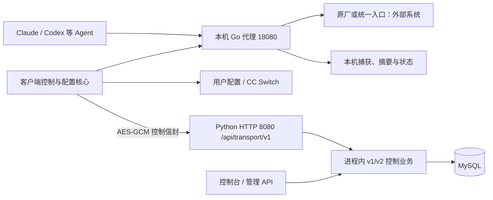

# EndpointAIProxy 项目地图

最后核查：2026-10-18。范围：Win/Mac 客户端与生产 Python 服务端；不覆盖外部模型网关内部实现。
本文记录架构与维护入口，不是发布通过证明。开始任务时，先确定目标组件，再读对应源码及验收记录。
本文描述仓库支持的架构与部署流程，未连接生产确认现场运行版本、账户配置或日志轮转状态。

## 当前版本与事实来源

| 组件 | 当前定位 | 事实来源 |
|---|---|---|
| Go 客户端 0.2.2 | Win/Mac 共用核心的候选实现，尚未满足正式替换条件 | [Go 模块](go-client/go.mod)、[功能矩阵](docs/GO-CLIENT-PARITY.md)、[阶段验收](docs/GO-CLIENT-VERIFICATION.md) |
| .NET 客户端 0.1.22 | 兼容基线与回退实现；不能因 Go 候选存在而删除 | [客户端项目](src/Sf.EndpointAI.Client.Service/Sf.EndpointAI.Client.Service.csproj)、[原 MSI](installer/Sf.EndpointAI.Setup/Package.wxs) |
| Python 服务端 0.1.24 候选 / 0.1.23 部署基线 | 生产控制面：Flask/Gunicorn、MySQL；不是模型请求转发器 | [服务端说明](server/README.md)、[入口](server/app.py)、[升级流程](deployment/README-SERVER-UPGRADE-0.1.23.md) |
| ASP.NET 控制服务 | 保留的独立原型，不等同于生产 Python 服务端 | [原型源码](src/Sf.EndpointAI.ControlServer) |

不要混用客户端版本、服务端版本或测试包版本。源码工作树、构建清单、最终程序哈希和交付 ZIP 可能处于不同阶段；不得只依据文件名认定内容一致。
阶段报告会变化，本文不复制所有包哈希、证书信息或环境结果。

## 两条链路

模型请求走本机代理；控制通信负责注册、策略、心跳、资产、事件及远程命令。两条链路的请求 ID 不能混用。
生产服务端的分析基于心跳、资产和活动状态，不保存完整逐请求代理日志；仅凭控制台不能还原所有模型请求故障。

## 客户端模块与功能

| 入口/模块 | 负责什么 | 修改前重点 |
|---|---|---|
| [cmd/endpointai](go-client/cmd/endpointai/main.go) | 参数、服务启动、维护与诊断入口 | 先占监听端口再打开状态；维护解除接管要求停服 |
| [app](go-client/internal/app/app.go) | 策略、心跳、资产、命令、配置协调及健康 | 控制同步与启停状态、锁顺序、恢复中的命令回执 |
| [proxy](go-client/internal/proxy/proxy.go) | 路由、原厂/统一入口、白名单、转发、SSE、取消及元数据签名 | 原始 body、错误传播、即时刷新、请求头覆盖 |
| [configuration](go-client/internal/configuration) | Claude JSON、Codex TOML、CC Switch、DSH YAML 接管与解除 | 备份、并发检测、原子替换、原配置及用户后续修改 |
| [state](go-client/internal/state/store.go) | SQLite 身份、路由、凭据、策略、操作状态及命令回执 | 旧版 schema、枚举和密文兼容；在线备份、只读诊断 |
| [protocol](go-client/internal/protocol) / [control](go-client/internal/control/client.go) | AES-GCM/HKDF、签名、控制信封、HTTP 调用 | 原始字节验签、日期/字段序列化与设备绑定 |
| [platform](go-client/internal/platform) / [protect](go-client/internal/protect) / [instance](go-client/internal/instance) | 系统服务、用户身份、密钥保护及单实例 | Windows DPAPI/权限与 Mac 文件密钥不能互相代替 |
| [discovery](go-client/internal/discovery) | CLI/IDE/Desktop 安装、进程与 Agent 发现 | Qoder 仅发现，不修改非公开配置 |
| [audit](go-client/internal/audit/audit.go) | 正文捕获、摘要、运行日志、压缩及保留清理 | 业务捕获与运行日志是不同可靠性/性能路径 |
| [observability](go-client/internal/observability) | 固定错误分类、阶段与安全系统码；禁止任意原始错误文本持久化 | 平台 errno、控制 ID 与模型 ID 分开 |
| [diagnostics](go-client/internal/diagnostics) | 本地健康、系统证据和脱敏诊断包 | 有界采集、部分失败、字段白名单及最新证据完整性 |

Windows 使用原生 Windows Service，安装辅助程序为 Go；Mac 使用 root LaunchDaemon。
两端业务以同一清单验证，平台操作采用等价实现；编译通过不等于平台行为通过。

## 稳定契约与数据布局

| 项目 | 契约 |
|---|---|
| 本地代理 | `127.0.0.1:18080`、`/r/{routeId}`、`/healthz` |
| Windows 服务名 | `SfEndpointAIProxy` |
| Mac LaunchDaemon | `com.sf.endpointai.proxy` |
| Windows 数据根 | `%ProgramData%\SF\EndpointAIProxy` |
| Mac 数据根 | `/Library/Application Support/SF/EndpointAIProxy` |
| 状态与恢复 | 数据根下 `state/client.db`、`config-backups`；Mac 另有 `state/machine.key` |
| 证据 | 数据根下 `captures`、`logs/service`、`diagnostics`；安装事务另有平台安装日志与恢复目录 |
| 转发元数据 | 统一入口模式使用 `x-sf-userid`、`x-request-id`，覆盖调用者伪造值；原厂透传行为保持既有约定 |
| 兼容边界 | SQLite schema/枚举、设备与路由身份、凭据、策略缓存、命令回执、密文布局和签名规则 |

以上系统路径用于说明产品契约，不是开发机源码路径。源码链接均相对本仓库。
新旧客户端不得同时写同一状态库或接管同一份配置。不要用删除状态库、重建密钥或重新注册设备来掩盖兼容问题。
Windows 沿用 DPAPI；Mac 沿用机器密钥文件与既有密文布局。策略签名针对实际响应原始正文，不能反序列化再序列化后验签。
控制命令与转发元数据签名的字段值、顺序、编码和时间格式也属于兼容契约。

## 生产 Python 服务端

| 入口/模块 | 职责 |
|---|---|
| [start.py](server/start.py) / [app.py](server/app.py) | 私有配置加载、应用工厂、Gunicorn 与请求日志 |
| [transport.py](server/controlserver/transport.py) | `/api/transport/v1` 信封校验、解密、数据库重放保护、进程内业务分发与响应加密 |
| [routes_client.py](server/controlserver/routes_client.py) | 注册、策略、心跳、事件和命令状态；命令通过心跳下发 |
| [routes_admin.py](server/controlserver/routes_admin.py) / [console.py](server/controlserver/console.py) / [analytics.py](server/controlserver/analytics.py) | 管理、控制台与当前终端分析 |
| [database.py](server/controlserver/database.py) / [数据库定义](server/conf/endpoint_ai_proxy.sql) | 事务、资产、策略、设备认证、命令租约、审计及结构检查 |
| [security.py](server/controlserver/security.py) / [validation.py](server/controlserver/validation.py) | 序列化、签名、认证比较与输入验证 |
| [backup.py](server/controlserver/backup.py) | 独立备份与恢复维护能力 |

当前 schema version 为 **2**，12 张表：`transport_replay`、`schema_migrations`、`control_policy`、`device_credentials`、`device_heartbeats`、`agent_inventory`、`device_runtime`、`agent_endpoint_assets`、`proxy_activity`、`endpoint_events`、`remote_commands`、`admin_audit_log`。
启动检查结构与 checksum；0.1.23 普通升级不做 schema 迁移，不执行 `init-db` 或 `migrate-db`，不生成新凭据。

外部客户端调用 HTTP 8080 的 `/api/transport/v1`，使用 AES-256-GCM 双向认证加密；直接网络访问 `/api/v1/`、`/api/v2/` 被拒绝。
HKDF 方向键、AAD、requestId、时间窗口、nonce/tag 长度及策略 HMAC 均是协议的一部分。数据库重放保护在认证后、业务分发前独立提交，依靠 request ID/nonce 唯一约束协调多 worker，不能换成进程内缓存。
管理页面/API 与加密客户端通道是不同边界；不要照旧 HTTPS 文档推断当前部署协议。

## 构建、交付与部署入口

- Windows：根 [Build-MSI.cmd](Build-MSI.cmd) → [构建脚本](scripts/Build-MSI.ps1) → [Go WiX 项目](installer/Sf.EndpointAI.Go.Setup/Sf.EndpointAI.Go.Setup.wixproj)。默认只构建；依赖、签名边界及 IOA 流程见 [Windows 交付说明](docs/WINDOWS-GO-DELIVERY.md)。构建机的 .NET SDK 用于 MSI 工具链，不进入 Go 终端载荷。
- Go 多架构：使用 [build.sh](go-client/scripts/build.sh)。模块锁定版本见 `go.mod`/`go.sum`；仓库本身不带 vendor，[源码打包器](scripts/package-windows-source.go) 在临时交付树生成 vendor，不能在未生成 vendor 的工作树直接使用 `-mod=vendor`。
- Mac：[Build-Pkg.sh](installer/macos/Build-Pkg.sh) 用 `CLIENT_IMPLEMENTATION=go` 选择 Go，旧 .NET 仍为默认。开发 bundle 布局包含平铺 launcher wrapper；不要假定 bundle 与平铺入口互斥。正式签名、公证和原生验收是独立步骤。
- 服务端：现有升级流程是 `appdeploy` 管理版本目录，`start.py` 读取私有 `launch-env.json` 后启动 `app.py`；Gunicorn 为 2 workers、每 worker 4 threads。`start.py` 会先清除相关已有环境变量，shell 临时 export 不一定生效。
- [生产升级脚本](deployment/update-server-0.1.23.py) 先准备新目录再切换，失败尝试恢复旧服务，保留回退来源；支持 Linux x86_64/aarch64，不设置开机自启，检测到 systemd 托管会拒绝。`server/deploy` 中的 service/backup 模板是另一套可选方式，不代表现场已经启用。
- 服务端实际升级流程使用版本目录下 `logs/app.log`、`console.log`；原轮转模板与此不同。新增 [appdeploy 模板](server/deploy/logrotate-appdeploy.conf) 与 [部署说明](server/deploy/LOG-ROTATION.md)，未安装；现场轮转仍须核对。

## 捕获、日志与排障经验

业务捕获会保留请求/响应正文；敏感 header 和 URL 字段有特定脱敏规则，**不等于正文全部脱敏**。
诊断包导出会移除正文、原始配置、数据库和凭据，不要把原始 captures 当作可公开共享的运行日志。

正文捕获在转发路径写入；完成阶段执行 Flush、文件同步、关闭、更名与写穿摘要。运行日志使用独立消费者，普通/优先队列为 4,096/256 项，非阻塞；压缩/清理另有 worker。成功请求按分钟聚合，失败限频并计数；正文捕获摘要继续逐请求保存。日志丢弃/写入失败与捕获降级分开计数，健康字段为 `auditDiagnostics`。停服等待 handler 收尾后关闭日志。
服务日志按 20 MiB 分片，清理总量 50→45 MiB；捕获目标 512 MiB，保留 7 天。活动文件及当日摘要豁免，属于软上限，不能承诺实时硬限制。
诊断采用最新有界窗口，搜索覆盖记录为 `evidence/search-coverage.json`；搜索不完整时不能把“未找到”当作“未发生”。已实现行为见 [修复报告](docs/CLIENT-FIX-VERIFICATION-20261016.md)。

重要坑点：

1. 配置写入必须备份、检查并发修改、原子替换并保留权限；解除接管尊重用户后续修改。历史路由检查失败时保留恢复记录，不能直接清空。
2. 新建用户文件与保留已有文件权限是两件事。新文件 owner 来自可信 profile；拒绝路径逃逸/符号链接，已有 metadata 保留。root/SYSTEM 测试不能由同 UID fixture 代替。Codex TOML 使用锁定解析器校验后按字节范围替换，不可回退为只匹配双引号的正则。
3. 维护解除接管前须先停止客户端，并确认端口与数据目录锁释放；卸载失败不应被当作成功。
4. 开发描述文件仅覆盖授权设备；开发签名启动通过不等于正式签名、公证和批量发行通过。
5. IOA 的分发成功、PKG/MSI 静态检查通过、服务实际就绪是不同事实。
6. 控制面离线时缓存状态可以继续代理；控制阶段已独立重试，策略失败不阻塞心跳与命令。缓存代理正常仍不能证明控制链路正常。
7. 一次延迟测试通过不代表稳定达标。保留失败样本与测量顺序，不为通过测试而降低捕获持久化语义。
8. 已修复的文件枚举/更名竞态与首次长稳失败不能强行画等号：首次证据不足，报告必须保留不确定性。

## 阶段状态、风险与后续入口

10 月 15 日旧 ARM64 程序完成 14,422.35 秒长稳；10 月 16 日修复版完成全量 Go race/vet、Windows 交叉构建、Rosetta 测试、32 项 Mac 脚本回归及 ARM64 72.71 秒 smoke。DSH 0.2.1 的四小时已通过；当前 0.2.2 的性能与四小时以新报告为准，不能继承旧结果。
Windows 原生 MSI、SYSTEM/DPAPI/ACL、安装回滚及 IOA 待验；Mac root 系统安装/跨 UID/重启卸载、真实 Intel 待验。旧 0.2.1 观测 A/B 最大 p95 增量 +5.23/+22.58 ms 是历史未通过证据。当前 0.2.2 r3 五轮 .NET +5 ms 门禁和四小时功能长稳已通过；独立新增观测预算、空闲内存与资源平台期仍待验，见 [资源复核](docs/CLIENT-PERFORMANCE-022-R3.md)。

原审查 R1–R6、O1–O8 已修复源码，见 [修复验证](docs/CLIENT-FIX-VERIFICATION-20261016.md)；[原始报告](docs/CLIENT-REVIEW.md) 保留历史证据，不把旧快照当作当前行为。没有生产部署或替换本机正式服务。
地图面向完整仓库。新日期后缀 Windows 源码包包含 `CONTEXT.md`、`AGENTS.md`、审查及修复文档；裁剪包不包含服务端、旧 .NET、Mac 材料和运行证据，相关链接须回完整仓库使用。
跨会话更新时应同步模块、地图与验收来源，区分“已实现 / 已验证 / 失败 / 待验”；不保存真实 token、密钥、证书私钥、用户配置或请求正文。

## DSH 接入（0.2.1 候选）

实施边界、部署顺序、恢复约束和实测证据见 [DSH 接入记录](docs/DSH-INTEGRATION-20261017.md)。AgentType 追加 11 / `deepseekHarness`，按 provider 区分 Messages/Responses/Chat；旧枚举和 SQLite schema 不变。默认关闭，先部署兼容控制面及验证网关，再在安装成功后启用。

首版要求已验证版本、明确静态 BaseURL 和可确认配置层级；账户登录、环境默认地址、动态/未知覆盖仅发现。DSH patch 替换整段 config，必须修改原 YAML 节点，不能追加不完整覆盖。恢复根日志不含凭据；旧 .NET 无 DSH 恢复能力，回退必须先用 Go 完成解除。profile 改名、删除或运行 overlay 存在时，完整引用检查失败不得退休路由。开发签名/模拟 SDK 通过不能替代 Desktop、SYSTEM/跨 UID、IOA 或真实网关验收。

2026-10-18 已复核冻结 DSH r3 的四小时功能长稳：14,417.04 秒、23,040 请求、3 次重启，捕获及配置恢复通过。资源趋势不能由功能 harness 自动通过推断；延迟、原生部署和真实网关联调仍待验，详见 DSH 接入记录。该版本历史 Windows 快照为 `0.2.1-20261018-source.zip`，旧 ZIP 保留。

## 0.2.2 / 0.1.24 修复与迁移

最新入口：[修复、性能与覆盖升级](docs/CLIENT-SERVER-022-024-20261018.md)。客户端修复摘要跨日竞态、DSH 原生参数、Mac ACL/xattr、回执冲突重试；提交后路由快照、预编译白名单和后台 SID 缓存减少请求开销。捕获正文 Sync 和摘要写穿不变；压缩采用有界低优先维护。

C# → Go 默认 MSI MajorUpgrade，沿用升级身份；`Upgrade-Client.cmd` 提供标准覆盖与显式受控 Reinstall，不因一般错误自动卸载。同版异 ProductCode 在 MSI 内拒绝，发布包不可变。数据根 `.installation-pending` 在安装提交前暂停配置/控制变更，不能随意删除来绕过恢复；状态/身份核验与原版健康检查属于安装事务。非默认旧数据根需显式迁移，不能误用默认数据库。Windows、root/跨 UID、真实 Intel 仍有原生门禁。

控制端必须使用新 0.1.24 交付；旧 0.1.23 ZIP 不含 DSH。新的升级器支持 0.1.23/22/21 并保留 schema 2 和凭据，已完成隔离 MySQL/.NET/Linux appdeploy 升级/回退，未生产部署。网关仍只读。0.2.2 r3 性能和四小时最终结果以 `verification-pipeline-022-20261018-r3.json` 为准。

2026-10-18 收尾补强：成功回退事务归档到 `InstallerState/Recovered`，提交恢复业务后的清理失败不再回滚旧状态。首轮 0.2.2 正式性能执行失败且未启动长稳，失败保留，复测使用独立证据文件；详情见本轮修复报告。

0.2.2 最终候选已推进 r3：修复 HTTP/1 首块 Flush 提前关闭入站请求体造成并发 SSE 截断；确定性修前失败/修后 race 回归通过。r2 二进制和首个 0.2.2 ZIP 为修复前材料，最终交付采用 r3，并重新执行性能/长稳。

2026-10-18 22:59 结果复核：r3 五轮 +5 ms 延迟门禁通过（最差 -0.084417 ms），四小时功能长稳 14,419.34 秒 / 23,040 请求 / 3 次重启通过。同一程序摘要，未生产部署。RSS 后段增长，资源平台期和独立日志预算仍待验，不写成全面发布通过。最新 Windows 材料 `EndpointAIProxy-Go-Windows-0.2.2-20261018-r3-verified-source.zip`，代码与 r3 相同，更新验收证据。
